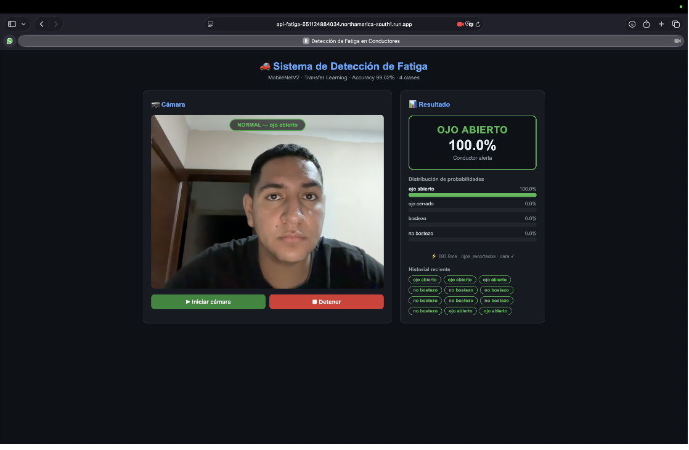
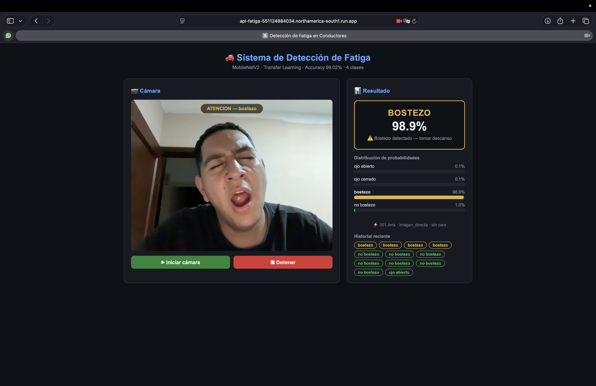
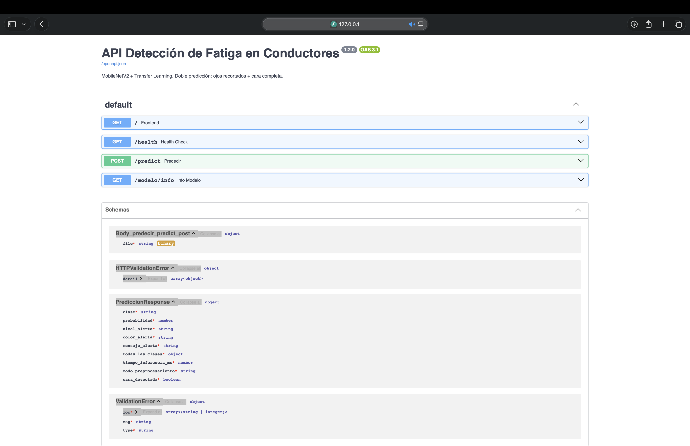

# Detección de Fatiga en Conductores

[](https://www.python.org/)
[](https://www.tensorflow.org/)
[](https://fastapi.tiangolo.com/)
[](https://www.docker.com/)
[](https://opensource.org/licenses/MIT)

Sistema de visión por computadora e inteligencia artificial que detecta señales de fatiga en conductores a partir de imágenes de la cámara web. Clasifica el estado del conductor en cuatro categorías (ojo abierto, ojo cerrado, bostezo, no bostezo) y genera alertas visuales en tiempo real.

Implementa una estrategia de doble predicción: una inferencia sobre la región de ojos y otra sobre la cara completa, eligiendo la de mayor confianza. El modelo MobileNetV2 con Transfer Learning alcanzó 99.02% de precisión en test.

---

## Tabla de contenidos

- [Contexto](#contexto)
- [Qué resuelve](#qué-resuelve)
- [Capturas](#capturas)
- [Arquitectura](#arquitectura)
- [Stack tecnológico](#stack-tecnológico)
- [Estructura del proyecto](#estructura-del-proyecto)
- [Instalación y uso](#instalación-y-uso)
- [Endpoints de la API](#endpoints-de-la-api)
- [Estrategia de doble predicción](#estrategia-de-doble-predicción)
- [Dataset y entrenamiento](#dataset-y-entrenamiento)
- [Mi rol](#mi-rol)
- [Documentación adicional](#documentación-adicional)
- [Licencia](#licencia)

---

## Contexto

La somnolencia al volante es una de las principales causas de accidentes de tránsito. Detectar señales tempranas de fatiga (ojos cerrándose, bostezos) puede prevenir incidentes si el sistema alerta al conductor a tiempo.

Este proyecto implementa un sistema completo de detección de fatiga: el frontend captura frames de la cámara web cada 800ms y los envía a una API FastAPI que aplica preprocesamiento con OpenCV (detección de cara, recorte de ojos, CLAHE) y clasifica el estado con un modelo MobileNetV2 entrenado con Transfer Learning.

Proyecto desarrollado en equipo para la materia de Visión por Computadora y Machine Learning.

---

## Qué resuelve

| Reto | Solución implementada |
|---|---|
| Detección robusta de señales de fatiga | Estrategia de doble predicción: región de ojos + cara completa |
| Diferencia entre imágenes de entrenamiento y uso real | Datasets contienen ojos recortados, la cámara captura cara completa |
| Preprocesamiento de imágenes en producción | Pipeline OpenCV: Haar Cascade → CLAHE → resize 224×224 → normalización |
| Compatibilidad con Mac M3 | Docker con `--platform=linux/amd64` y `tensorflow-cpu` dentro del contenedor |
| Alertas visuales en tiempo real | Frontend con captura automática cada 800ms y feedback codificado por color |

---

## Capturas

### Detección de ojo abierto

El conductor está alerta. La estrategia de doble predicción elige la región de ojos recortada porque ofrece mayor confianza.



### Detección de bostezo

El sistema identifica un bostezo (98.9% de confianza) y muestra una alerta de atención.



### Documentación interactiva de la API (Swagger UI)



---

## Arquitectura

```
[ Cámara web del conductor ]
       |
       | Frames cada 800ms (JPEG)
       v
[ Frontend HTML5 ]
       |
       | multipart/form-data
       v
[ Docker Puerto 8000:8000 ]
       |
       v
[ FastAPI + Uvicorn ]
       |
       | Detección de cara (Haar Cascade)
       | Recorte región de ojos
       | CLAHE + resize + normalización
       v
[ Modelo MobileNetV2 (modelo_fatiga.keras) ]
       |
       | 4 probabilidades (softmax)
       v
[ JSON Response: clase + confianza + nivel_alerta + modo ]
       |
       v
[ Frontend: alerta visual + barras + historial ]
```

---

## Stack tecnológico

| Componente | Tecnología |
|---|---|
| Lenguaje | Python 3.12 |
| Modelo IA | TensorFlow / Keras 2.16 |
| Arquitectura | MobileNetV2 + Transfer Learning |
| Visión por computadora | OpenCV 4.11 |
| API | FastAPI 0.115 + Uvicorn |
| Contenedor | Docker con plataforma `linux/amd64` |
| Frontend | HTML5 + JavaScript + Canvas API |

---

## Estructura del proyecto

```
deteccion-fatiga-conductores/
├── api/
│   ├── Dockerfile
│   ├── main.py                          # API FastAPI
│   ├── requirements.txt
│   ├── frontend/
│   │   └── index.html                   # Interfaz con cámara
│   └── model/
│       ├── modelo_fatiga.keras          # Modelo entrenado
│       ├── modelo_fatiga_metadata.json
│       └── cascades/
│           ├── haarcascade_frontalface_default.xml
│           └── haarcascade_eye.xml
├── docs/
│   ├── documentacion-tecnica.pdf
│   └── guia-despliegue.md
├── capturas/
├── LICENSE
└── README.md
```

---

## Instalación y uso

### Requisitos

- Python 3.12 (recomendado: instalar con `pyenv`)
- Docker Desktop (para la variante con contenedor)

### Opción A - Correr local con Uvicorn

1. Clonar el repositorio

   ```bash
   git clone https://github.com/AngelCanelaaa/deteccion-fatiga-conductores.git
   cd deteccion-fatiga-conductores
   ```

2. Crear y activar entorno virtual

   ```bash
   python -m venv venv
   source venv/bin/activate
   ```

3. Instalar dependencias

   ```bash
   pip install -r api/requirements.txt
   ```

4. Levantar la API

   ```bash
   cd api
   uvicorn main:app --reload
   ```

5. Abrir el frontend

   Abre `http://localhost:8000/` en el navegador. La cámara te pedirá permiso.

### Opción B - Correr con Docker

```bash
cd api
docker buildx build --platform linux/amd64 -t img-fatiga .
docker run -d --name srv-fatiga -p 8000:8000 img-fatiga:latest
```

Verificar que corre:

```bash
docker ps
```

Abrir `http://localhost:8000/` para la interfaz, `http://localhost:8000/docs` para Swagger.

---

## Endpoints de la API

| Método | Endpoint | Descripción |
|---|---|---|
| GET | `/` | Sirve el frontend HTML |
| GET | `/health` | Estado del modelo y sistema |
| POST | `/predict` | Recibe imagen, devuelve clase + confianza + nivel de alerta |
| GET | `/modelo/info` | Información técnica del modelo |

Ejemplo de respuesta de `/predict`:

```json
{
  "clase": "ojo_cerrado",
  "probabilidad": 0.9923,
  "nivel_alerta": "PELIGRO",
  "color_alerta": "#F44336",
  "mensaje_alerta": "Ojos cerrados - posible fatiga",
  "todas_las_clases": {
    "ojo_abierto": 0.0041,
    "ojo_cerrado": 0.9923,
    "bostezo": 0.0022,
    "no_bostezo": 0.0014
  },
  "tiempo_inferencia_ms": 43.7,
  "modo_preprocesamiento": "ojos_recortados",
  "cara_detectada": true
}
```

**Niveles de alerta:**

| Clase | Nivel | Color | Acción |
|---|---|---|---|
| ojo_abierto | NORMAL | Verde | Sin acción |
| no_bostezo | NORMAL | Verde | Sin acción |
| bostezo | ATENCIÓN | Naranja | Sugerir descanso |
| ojo_cerrado | PELIGRO | Rojo | Alarma inmediata |

---

## Estrategia de doble predicción

El modelo se entrenó con tres datasets que contienen imágenes de ojos recortados. Sin embargo, la cámara web captura el rostro completo del conductor. Para cerrar esa brecha, se implementó una estrategia de doble predicción:

1. **Predicción A — Región de ojos:** se recorta la mitad superior de la cara detectada y se busca un ojo individual. Especializada en `ojo_abierto` / `ojo_cerrado`.
2. **Predicción B — Cara completa:** se recorta toda la cara. Especializada en `bostezo` / `no_bostezo`.
3. **Decisión final:** se compara la confianza máxima de A en clases de ojos contra la confianza máxima de B en clases de boca. Gana la mayor.
4. **Fallback:** si no se detecta cara, se predice directamente con la imagen completa.

El campo `modo_preprocesamiento` en la respuesta indica cuál ruta se tomó.

---

## Dataset y entrenamiento

**Datasets utilizados** (todos públicos en Kaggle):

| Dataset | Imágenes | Clases originales |
|---|---|---|
| MRL Eye Dataset | 4,000 | Open_Eyes, Closed_Eyes |
| Yawn Eye Dataset | 2,900 | yawn, no_yawn, Open, Closed |
| Drowsiness / CEW | 47,992 | open_eye, closed_eye |
| **Total** | **54,892** | **4 clases unificadas** |

**Preprocesamiento aplicado:**

- Curación: verificación MD5, eliminación de 8 imágenes corruptas (0.02%).
- CLAHE en espacio LAB: mejora de contraste +48% (MRL) y +60.5% (CEW).
- Resize a 224×224 px.
- Normalización a [0, 1].
- División estratificada 70/15/15 (semilla 42).

**Entrenamiento (MobileNetV2 + Transfer Learning):**

- Fase 1 — Feature Extraction (10 epochs, backbone congelado): 97.15% val accuracy.
- Fase 2 — Fine-Tuning (15 epochs, últimas 30 capas descongeladas, LR=1e-5): 99.08% val accuracy.
- Test accuracy final: **99.02%**.
- Modelo: 3,049,284 parámetros, 29.9 MB.

---

## Roles del equipo

Proyecto desarrollado en equipo por tres integrantes.

**Ángel de Jesús Canela Figueroa**
- Implementación de la estrategia de doble predicción en el backend.
- Desarrollo del pipeline de preprocesamiento (Haar Cascade, CLAHE, recorte inteligente).
- Configuración del Dockerfile para compatibilidad con Mac M3 (Apple Silicon).
- Preparación del despliegue en Google Cloud Run.
- Documentación técnica y guía de despliegue.

### Isamar Chávez Díaz

- **Entrenamiento, fase 1:** Transfer Learning con MobileNetV2 y backbone congelado (10 epochs), con 97.15 % de precisión en validación.
- **Preparación de los datasets:** integración de tres datasets públicos de Kaggle (54,892 imágenes) en 4 clases unificadas.
- **Curación y preprocesamiento de datos:** verificación MD5 (8 imágenes corruptas eliminadas), mejora de contraste con CLAHE en espacio LAB, redimensionado a 224×224, normalización y división estratificada 70/15/15.
- **Entrenamiento del modelo** (en conjunto): participación en el entrenamiento de MobileNetV2 con Transfer Learning y Fine-Tuning.
- **Interfaz web** (en conjunto): participación en el desarrollo del frontend con cámara, alertas visuales y barras de probabilidad.
- **Pruebas del sistema:** validación de punta a punta de la cámara, la API y la alerta visual.

### Katia Paola Victoria Escalera

- **Entrenamiento, fase 2:** Fine-Tuning descongelando las últimas 30 capas con learning rate de 1e-5 (15 epochs), con 99.08 % de precisión en validación.
- **Evaluación del modelo:** medición sobre el conjunto de test, con una precisión final de 99.02 %.
- **Interfaz web:** desarrollo del frontend en HTML5, JavaScript y Canvas API, con acceso a la cámara web y captura automática de frames cada 800 ms.
- **Preparación de los datasets** (en conjunto): integración de tres datasets públicos de Kaggle (54,892 imágenes) en 4 clases unificadas.
- **Curación y preprocesamiento de datos** (en conjunto): verificación MD5, mejora de contraste con CLAHE, redimensionado a 224×224, normalización y división estratificada 70/15/15.
- **Pruebas del sistema** (en conjunto): validación de punta a punta de la cámara, la API y la alerta visual.

---

## Documentación adicional

- [Documentación técnica](docs/documentacion-tecnica.pdf) - informe completo del proyecto.
- [Guía de despliegue](docs/guia-despliegue.md) - proceso de despliegue en Google Cloud Run.

---

## Licencia

MIT - ver [LICENSE](LICENSE).

---

**Autores:** Angel de Jesús Canela Figueroa, Isamar Chávez Díaz y Katia Paola Victoria Escalera
**Institución:** Instituto Tecnológico de Jiquilpan (TecNM)
**Materia:** Visión por Computadora y Machine Learning
**Programa:** Ingeniería en Sistemas Computacionales
